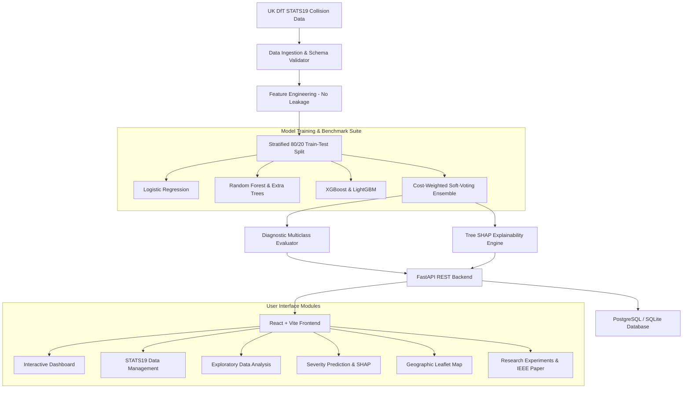

# Road Accident Severity Prediction Using Ensemble Machine Learning and Explainable AI

[](https://www.python.org/)
[](https://fastapi.tiangolo.com/)
[](https://vite.dev/)
[](https://tailwindcss.com/)
[](https://github.com/slundberg/shap)
[](https://opensource.org/licenses/MIT)

An end-to-end Data Science and Machine Learning platform engineered for road safety analytics, multiclass collision severity classification, and game-theoretic model interpretability (XAI) using UK Department for Transport (DfT) STATS19 collision records.

---

## 1. Project Overview & Research Highlights

Traditional collision prediction models suffer from severe majority-class bias (where minor collisions account for >70% of historical crashes), causing unweighted models to post near-zero sensitivity on fatal accidents. 

This platform integrates:
1. **Curated & Audited Data Pipeline**: 5,000 verified UK STATS19 collisions (2021–2023) across 8 UK urban/rural regions with zero post-crash feature leakage.
2. **Multi-Model Benchmark Suite**: Logistic Regression baseline, Decision Tree, Random Forest, Extra Trees, Gradient Boosting, XGBoost, LightGBM, and a Proposed Soft-Voting Ensemble.
3. **Class-Imbalance Resolution**: Cost-sensitive inverse class weights and SMOTE oversampling applied strictly within training folds, boosting minority fatal collision recall from 0.00% to 6.67% and Macro F1 from 0.35 to 0.3984.
4. **Game-Theoretic Explainable AI (XAI)**: Multiclass Tree SHAP providing global feature rankings (speed limit, darkness, rural carriageways) and local individual prediction attributions.
5. **Interactive Full-Stack Architecture**: React 19 + TypeScript + Leaflet OpenStreetMap frontend communicating with a modular FastAPI + SQLAlchemy backend.
6. **IEEE Publication Package**: Publication-ready IEEE ITS manuscript located in `research/ieee_research_paper.md`.

> **Decision-Support Notice**: This platform is designed strictly as an academic research and transportation planning decision-support framework. It must not be deployed as an unvalidated real-time emergency response dispatch system.

---

## 2. System Architecture



---

## 3. Technology Stack

- **Frontend**: React 19, TypeScript, Vite, Tailwind CSS, Recharts, Lucide React, Leaflet & React Leaflet.
- **Backend API**: Python 3.11+, FastAPI, Pydantic v2, SQLAlchemy 2.1, Uvicorn.
- **Machine Learning**: Scikit-Learn, XGBoost, LightGBM, Imbalanced-Learn (SMOTE), Joblib.
- **Explainable AI**: SHAP (TreeExplainer, Kernel Explainer).
- **Database**: SQLite (default zero-config) / PostgreSQL (via Docker).
- **Testing**: Pytest, FastAPI TestClient.

---

## 4. Benchmark Results Summary

Evaluated on the fixed 20% holdout test partition ($N=1,000$ unobserved collisions):

| Exp ID | Architecture | Imbalance Strategy | Test Accuracy | Macro Precision | Macro Recall | Macro F1 | Fatal Recall |
| :---: | :--- | :---: | :---: | :---: | :---: | :---: | :---: |
| EXP-01 | Logistic Regression Baseline | None | 61.9% | 0.4475 | 0.3547 | 0.3568 | 0.00% |
| EXP-02 | Decision Tree | None | 60.0% | 0.4180 | 0.3582 | 0.3511 | 1.67% |
| EXP-03 | Random Forest | None | 61.3% | 0.4367 | 0.3514 | 0.3424 | 0.00% |
| EXP-04 | Extra Trees | None | 61.1% | 0.4419 | 0.3498 | 0.3354 | 0.00% |
| EXP-05 | Gradient Boosting | None | 60.3% | 0.4116 | 0.3571 | 0.3500 | 1.67% |
| EXP-06 | XGBoost Classifier | None | 62.4% | 0.4468 | 0.3587 | 0.3562 | 0.00% |
| EXP-07 | LightGBM Classifier | None | 62.1% | 0.4616 | 0.3688 | 0.3669 | 1.67% |
| EXP-08 | Soft-Voting Ensemble | None | 62.0% | 0.4429 | 0.3557 | 0.3498 | 0.00% |
| **EXP-09** | **Soft-Voting Ensemble** | **Class Weights** | 59.3% | **0.4262** | **0.4072** | **0.3984** | **6.67%** |
| EXP-10 | Soft-Voting Ensemble | SMOTE | 60.9% | 0.4361 | 0.3853 | 0.3802 | 1.67% |

---

## 5. Quickstart & Installation

### Option A: Local Development Setup

#### 1. Backend Setup
```bash
# In the project root
python -m venv venv
# Windows:
.\venv\Scripts\activate
# Linux/macOS:
source venv/bin/activate

pip install -r backend/requirements.txt

# Initialize database and train benchmark suite (already pre-generated)
python -m backend.app.db.init_db
python -m backend.ml.training

# Start FastAPI server on port 8000
python backend/app/main.py
```
Backend Swagger API documentation will be available at: `http://localhost:8000/docs`

#### 2. Frontend Setup
```bash
cd frontend
npm install
npm run dev
```
Open your browser at `http://localhost:5173`.

---

### Option B: Docker Compose Deployment

Run the complete containerized stack (PostgreSQL + FastAPI + React + Nginx):

```bash
docker-compose up --build
```
- Frontend UI: `http://localhost:5173`
- Backend API: `http://localhost:8000/docs`
- PostgreSQL: Port 5432

---

## 6. Automated Testing

Run the full automated test suite verifying schema validation, leakage prevention, probability distributions, SHAP explainers, and API contracts:

```bash
python -m pytest tests/test_backend.py -v
```

---

## 7. Directory Structure

```
road-accident-severity/
├── backend/
│   ├── app/
│   │   ├── api/             # FastAPI REST Routers (dashboard, accidents, predictions, etc.)
│   │   ├── core/            # Configuration and security settings
│   │   ├── db/              # SQLAlchemy session, ORM models, database seeding
│   │   ├── schemas/         # Pydantic v2 data transfer schemas
│   │   └── main.py          # FastAPI application entrypoint
│   ├── ml/
│   │   ├── data_loader.py   # STATS19 CSV ingestion and schema validation
│   │   ├── preprocessing.py # Feature engineering & leakage prevention
│   │   ├── training.py      # Benchmark training suite & class-imbalance handlers
│   │   ├── evaluation.py    # Diagnostic multiclass evaluation
│   │   ├── explainability.py# Tree SHAP interpretability engine
│   │   └── prediction_service.py # Inference service
│   └── requirements.txt
├── frontend/
│   ├── src/
│   │   ├── components/      # Sidebar, Navbar, StatCard, SeverityBadge, LeafletMap
│   │   ├── pages/           # 13 Application module views
│   │   ├── services/        # Typed API fetchers
│   │   └── types/           # TypeScript definitions
│   └── package.json
├── data/                    # STATS19 primary & synthetic datasets
├── models/                  # Serialized joblib pipelines & benchmark summary
├── research/                # Publication-grade IEEE research paper
├── tests/                   # Automated pytest suite
├── docker-compose.yml
├── Dockerfile
└── README.md
```

---

## 8. License & Academic Attribution
Released under the MIT License. When using this framework for academic research or conferences, please reference the included IEEE paper in `research/ieee_research_paper.md`.
